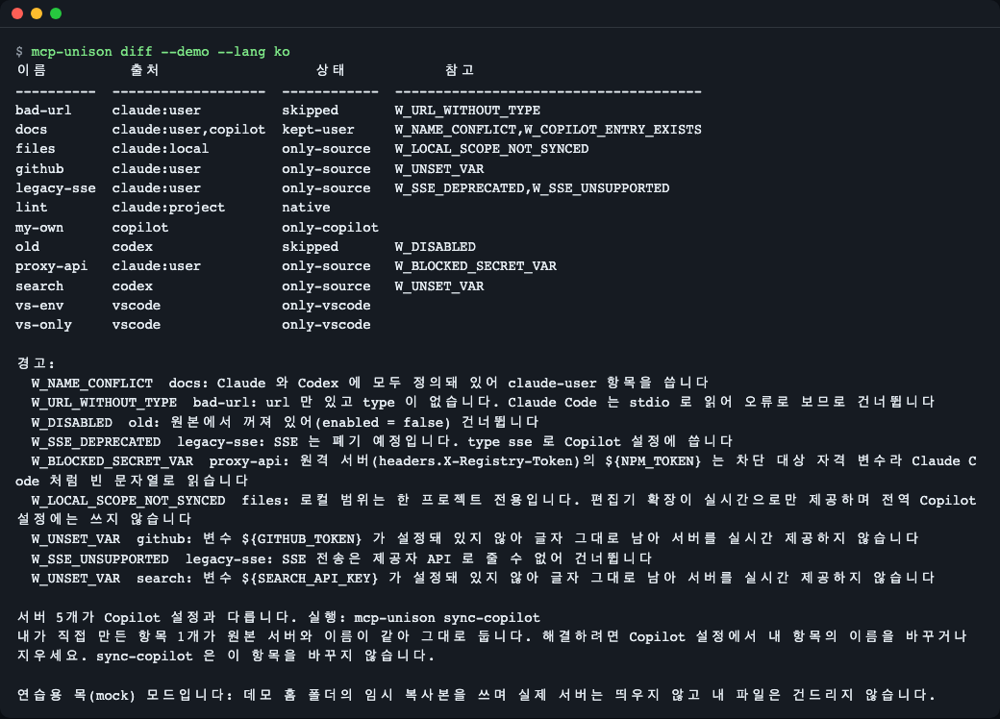
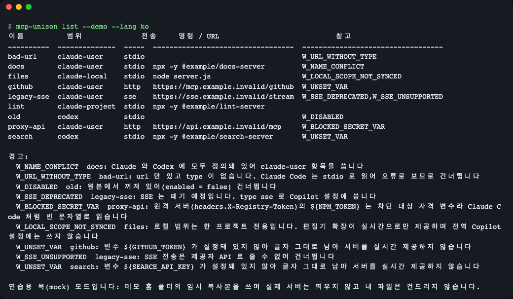
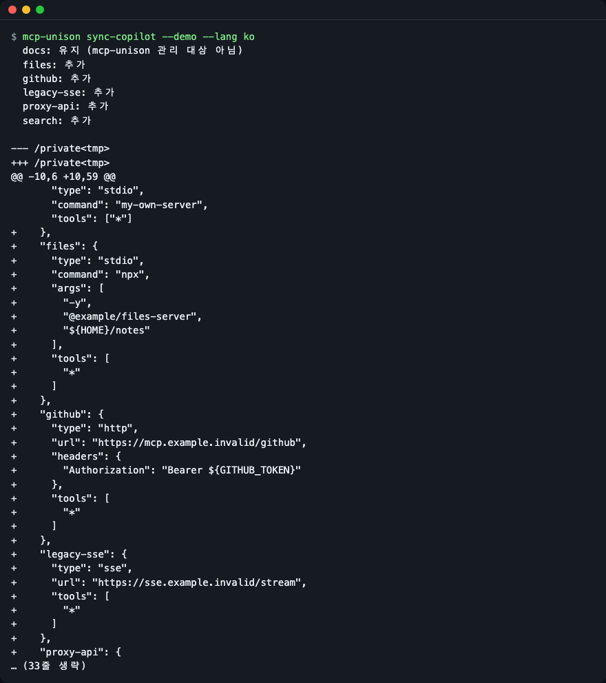
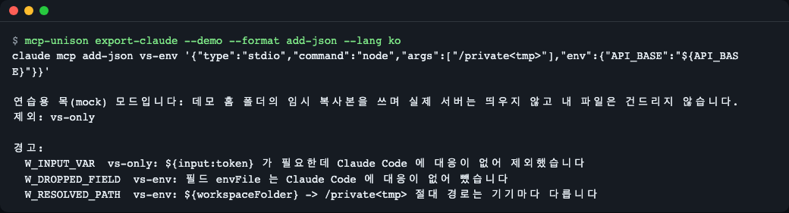
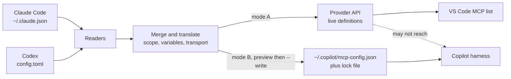

# MCP Unison

[English](README.md) | **한국어**

Claude Code나 Codex에 이미 등록한 MCP 서버를 VS Code 채팅(Copilot)에서 손으로 다시 적지 않고 쓰게 해 주는 VS Code 확장입니다. 같은 코어로 만든 CLI도 함께 냅니다. VS Code의 MCP 서버 정의 제공자 API로 서버를 등록하고, 미리보기를 거쳐 Copilot 설정 파일에 쓸 수도 있으며, 옮기지 못하는 서버는 경고 코드로 이유를 알려 줍니다.


*`mcp-unison diff --demo`: 서버마다 한 줄. 어디에 정의됐는지, Copilot 설정과 같은지 보여 주고, 옮겨지지 않는 서버는 경고 코드로 설명합니다.*

## 무엇을 더해 주나요

- **하나의 출처.** Claude Code(`~/.claude.json` 의 사용자·로컬 범위)와 Codex(`config.toml`)의 서버를 복사 없이 VS Code에 제공합니다(모드 A, "실시간 제공자").
- **안전한 쓰기 경로.** `sync-copilot` 은 diff를 미리 보여 주고 `--write` 를 줄 때만 `~/.copilot/mcp-config.json` 에 이 도구가 만든 항목을 추가·갱신합니다. 내 항목·주석·다른 키는 바이트 그대로 남습니다(모드 B, "파일 쓰기").
- **원본에 충실한 변환.** 범위 우선순위·변수 규칙·전송 방식 차이는 Claude Code의 동작을 따르고 테스트로 고정했습니다. 옮길 수 없는 것은 이유(`W_*` 코드)와 함께 건너뜁니다. 영어·한국어로 표시됩니다.

## 요구 사항

| 호스트 | 확인한 버전 | 비고 |
|---|---|---|
| VS Code | `^1.101.0` 이상 필요, 프로브는 1.146.0 에서 실행 | 확장 호스트 API `vscode.lm.registerMcpServerDefinitionProvider` |
| Node.js | 20 이상(26.13.0 에서 확인) | CLI 전용. 확장은 VS Code 안에서 돌아갑니다 |
| Claude Code / Codex | `~/.claude.json` / `~/.codex/config.toml` 을 쓰는 버전 | 파일만 읽습니다. 두 도구를 실행하지 않습니다 |

## 설치

확장은 아직 마켓플레이스에 없습니다. clone 해서 패키지를 만든 뒤 파일로 설치합니다.

```bash
git clone https://github.com/LeeGyeongPil/mcp-unison.git
cd mcp-unison
npm install
npm run package          # mcp-unison-0.1.0.vsix 를 만듭니다
```

VS Code에서 **Extensions: Install from VSIX...** 를 실행하고 `mcp-unison-0.1.0.vsix` 를 고릅니다.

CLI는 같은 clone에서 쓸 수 있습니다.

```bash
npm start                # 빌드 후 mcp-unison diff --demo 실행
node out/src/cli.js --help
```

Node.js 20 이상이 필요합니다(macOS는 `brew install node`, 또는 nodejs.org 설치 파일).

## 빠르게 시작하기 (연습용 목 모드)

`--demo` 는 **연습용 목(mock) 모드**입니다. 들어 있는 예시 홈 폴더(`examples/demo-home`)를 임시 폴더에 복사해 진짜 변환 코드를 돌립니다. 서버를 띄우지 않고 네트워크도 쓰지 않으며 내 파일은 건드리지 않습니다. 실제 모드(`--demo` 없음)는 내 `~/.claude.json`, `~/.codex/config.toml`, `~/.copilot/mcp-config.json` 을 읽습니다.

```bash
npm start
```

```text
Practice mock mode: a throwaway copy of the demo home folder is used; no real server is started and your files are not touched.
NAME        SOURCES              STATUS        NOTES
----------  -------------------  ------------  --------------------------------------
bad-url     claude:user          skipped       W_URL_WITHOUT_TYPE
docs        claude:user,copilot  kept-user     W_NAME_CONFLICT,W_COPILOT_ENTRY_EXISTS
files       claude:local         only-source   W_LOCAL_SCOPE_NOT_SYNCED
github      claude:user          only-source   W_UNSET_VAR
legacy-sse  claude:user          only-source   W_SSE_DEPRECATED,W_SSE_UNSUPPORTED
lint        claude:project       native
my-own      copilot              only-copilot
old         codex                skipped       W_DISABLED
proxy-api   claude:user          only-source   W_BLOCKED_SECRET_VAR
search      codex                only-source   W_UNSET_VAR
vs-env      vscode               only-vscode
vs-only     vscode               only-vscode
```

위 출력은 영어 화면입니다. 출력 언어는 `--lang`, `MCP_UNISON_LANG`, `LANG` 순으로 정해지므로 한국어 로캘 셸에서는 같은 명령이 한국어로 나옵니다. 영어로 고정하려면 `node out/src/cli.js diff --demo --lang en`. 표 아래에는 `Warnings:` 목록과 요약 줄이 이어집니다. 셸에 `GITHUB_TOKEN`·`SEARCH_API_KEY` 가 설정돼 있으면 `W_UNSET_VAR` 줄이 사라지므로 출력이 조금 다를 수 있습니다.

## 사용법

### 상태 값

| STATUS | 뜻 |
|---|---|
| `only-source` | Claude Code 또는 Codex에는 있고 Copilot 설정에는 없음 |
| `same` | 양쪽에 있고 같음 |
| `different` | 양쪽에 있지만 다름 |
| `kept-user` | 같은 이름의 내 항목이 있음. 드리프트 아님. 내 항목의 이름을 바꾸거나 지우세요. `sync-copilot` 은 건드리지 않음 |
| `stale-managed` | 이전 동기화가 쓴 항목인데 더는 필요 없음. 다음 동기화가 지움. 드리프트로 셈 |
| `native` | VS Code가 이미 직접 읽음(프로젝트 `.mcp.json`), 할 일 없음 |
| `only-copilot` | 내 항목. 절대 건드리지 않음 |
| `only-vscode` | `.vscode/mcp.json` 에만 있음 |
| `skipped` | 변환할 수 없음. 경고 코드 참고 |

### 1. 살펴보기: `list`, `diff`


*`mcp-unison list --demo`: 각 서버의 종류(stdio, http, sse)와 표시된 이유.*

`diff --check` 는 원본과 Copilot 설정이 다르면 종료 코드 1을 냅니다. CI나 셸 프롬프트 훅에 쓰기 좋습니다. 기계가 읽는 출력은 `--json`.

### 2. Copilot 설정에 동기화: `sync-copilot`


*`mcp-unison sync-copilot --demo`: 미리보기일 뿐입니다. `docs` 는 같은 이름의 내 항목이 이미 있어 그대로 둡니다.*

기본은 미리보기이며 파일을 바꾸지 않습니다. 적용하려면 `--write` 를 붙입니다. 쓰기는 설정 옆 `mcp-unison.lock.json` 에 기록된 항목만 추가·갱신·삭제하고, `.bak` 백업을 남기며, 손으로 고친 관리 항목은 충돌(종료 1)로 알립니다. 두 번째 실행은 `no changes` 를 출력합니다. 기존 파일의 권한은 유지되고(새 파일과 lock 파일은 0600), 심볼릭 링크 설정은 실제 파일에 쓰며, `.bak` 도 같은 권한입니다. Claude Code 로컬 범위 서버는 쓰지 않습니다(아래 `W_LOCAL_SCOPE_NOT_SYNCED` 참고). 변수는 값이 아니라 `${NAME}` 형태로 쓰므로 비밀 값이 파일에 복사되지 않습니다.

VS Code에서는 같은 흐름이 **MCP Unison: Sync to Copilot config** 명령입니다(먼저 diff, 확인 후 쓰기).

### 3. 반대로 내보내기: `export-claude`


*`mcp-unison export-claude --demo --format add-json`: 바로 붙여 넣을 수 있는 `claude mcp add-json` 명령. `${input:...}` 가 필요한 서버는 제외됩니다.*

### VS Code 명령

| 명령 | 하는 일 |
|---|---|
| MCP Unison: Refresh | 원본을 지금 다시 읽음 |
| MCP Unison: Sync to Copilot config | 미리보기, 확인, 관리 항목 쓰기 |
| MCP Unison: Show Drift | `diff` 와 같은 표 표시 |
| MCP Unison: Export to Claude Code | `.vscode/mcp.json` 변환 |
| MCP Unison: Show in Copilot Sessions | 확장이 제공한 서버를 불러오도록 유도(아래 참고) |
| MCP Unison: Choose Language | 영어 또는 한국어, 전역 저장 |

빌드 환경에서는 VS Code 창 자체를 촬영할 수 없어 이 README의 스크린샷은 CLI 화면입니다. 확장의 제공자 로직은 `vscode` 모듈 대역으로 테스트했고, 실제 편집기 테스트는 작성돼 있지만 CI에서만 돕니다(개발 절 참고).

## 설정

| 키 | 기본값 | 설명 |
|---|---|---|
| `mcpUnison.sources.claude` | `true` | Claude Code 서버 읽기 |
| `mcpUnison.sources.codex` | `true` | Codex 서버 읽기 |
| `mcpUnison.copilotSync` | `ask` | `off`, `ask`, `auto`: 변경을 Copilot 설정에 쓸지 |
| `mcpUnison.blockedRemoteVars` | `[]` | 원격 `url`·`headers` 에서 추가로 막을 변수 이름 |
| `mcpUnison.language` | `auto` | `auto`, `en`, `ko`. `auto` 는 편집기 언어로 한 번 결정 |

CLI 언어: `--lang en|ko`, 다음 `MCP_UNISON_LANG` 환경 변수, 다음 `LC_ALL`·`LC_MESSAGES`·`LANG`. 한국어가 아니면 영어입니다. 그 밖의 변수: `CODEX_HOME`·`COPILOT_HOME` 은 Codex·Copilot 폴더를 옮기고, `--home <폴더>` 는 둘 다 덮어씁니다.

## 동작 원리



1. 읽기 단계가 원본 파일을 파싱합니다. 파싱 오류는 파일 경로와 함께 멈춥니다(종료 2).
2. 병합은 Claude Code를 따릅니다. 로컬 범위 > 프로젝트 > 사용자이고, 같은 이름은 항목 전체를 교체합니다(필드를 합치지 않음). Claude와 Codex 이름이 겹치면 Claude가 이기고 `W_NAME_CONFLICT` 가 붙습니다.
3. 변수: 미설정 `${VAR}` 는 글자 그대로 두고 `W_UNSET_VAR`. 빈 문자열은 설정된 값이라 `${VAR:-d}` 는 빈 값이 됩니다. 원격 `url`·`headers` 안의 자격 변수(`NPM_TOKEN`, `ANTHROPIC_API_KEY` 등)는 빈 값으로 읽고 `W_BLOCKED_SECRET_VAR`. 중괄호 없는 `$VAR` 는 글자 그대로입니다.
4. 모드 A 는 `vscode.lm.registerMcpServerDefinitionProvider` 로 정의를 VS Code에 넘깁니다. 미설정 변수가 있는 서버, SSE 전송, `type` 없는 `url` 은 내놓지 않습니다. 정의마다 내용 해시를 `version` 으로 달아 바뀐 서버만 변경으로 알립니다.
5. 모드 B 는 일반 JSON 편집기가 테스트에서 주변 사용자 줄의 서식을 바꿔 버렸기 때문에, Copilot 설정 문자열을 최소 단위로 이어 붙여 씁니다.

접근 범위: 확장은 위 설정 파일을 읽고, 폴링(기본 1초)으로 변경을 감시하며, 사용자가 확인할 때만 Copilot 설정 파일 하나에 씁니다. 네트워크 호출도, MCP 서버 실행도 없습니다.

### 지금은 파일 쓰기가 주 경로인 이유

실시간 제공자(모드 A)가 더 깔끔한 방식이지만, VS Code 기본 Copilot harness가 확장이 제공한 서버를 항상 보지는 못합니다: [microsoft/vscode#343729](https://github.com/microsoft/vscode/issues/343729)(작성 시점에 열려 있음, 보고서에는 1.143.1 재현). 확장 제공 서버 모음은 지연 로드되며, 로컬 채팅 요청·`MCP: List Servers`·새로고침 버튼으로만 로드가 일어납니다. Agent Host 세션에는 서버가 안 보일 수 있습니다. 고쳐질 때까지는 **Sync to Copilot config(모드 B)** 를 확실한 경로로 보고, 모드 A 는 되는 곳에서의 덤으로 생각하세요. `MCP Unison: Show in Copilot Sessions` 는 지연 로드를 유도합니다.

솔직한 한계 두 가지.

- 조직 허용 목록이 확장 제공 서버에는 적용되지 않을 수 있습니다([#345036](https://github.com/microsoft/vscode/issues/345036)). 관리되는 컴퓨터에서는 서버가 막힐 수 있습니다.
- Copilot 항목 키(`type`, `tools: ["*"]`)는 파일 형식 조사 노트를 따랐습니다. 실제 Copilot 세션에서 확인하지는 않았습니다.

## 어떤 모드를 쓸까요?

| 상황 | 쓸 것 |
|---|---|
| 지금 Copilot 에이전트 세션에서 서버를 쓰고 싶다 | 모드 B: **Sync to Copilot config** (`sync-copilot --write`) |
| 파일을 쓰지 않고 VS Code MCP 목록에 서버가 보이게 하고 싶다 | 모드 A: 실시간 제공자(설치 후 기본 켜짐) |
| Claude Code 로컬 범위 서버(한 프로젝트 전용)가 필요하다 | 모드 A 만. 전역 Copilot 파일에는 절대 쓰지 않음 |
| CI에서 드리프트를 알고 싶다 | `diff --check` (드리프트면 종료 1) |
| 조직이 관리하는 컴퓨터다 | 먼저 관리자에게 확인. 알려진 한계 참고 |

잘 맞는 경우: Claude Code나 Codex에 MCP 서버를 등록해 뒀고, 같은 서버를 VS Code 채팅에서도 쓰고 싶으며, 파일에 쓰기 전에 diff를 보고 싶을 때. `.vscode/mcp.json` 을 직접 편집하려면 VS Code의 [내장 MCP 지원](https://code.visualstudio.com/docs/copilot/customization/mcp-servers)을 쓰세요. 여러 에이전트 도구가 쓰는 MCP 목록을 한곳에서 관리하려면 각 도구가 자체 공유·가져오기 기능을 문서화했는지 확인해 보세요.

## 무엇이 변환되고 무엇이 건너뛰어지나

필드 대응(원본 → Copilot 설정 항목):

| 원본 | 필드 | 결과 | 비고 |
|---|---|---|---|
| Claude Code, Codex | `command`, `args`, `env` | 같은 필드, `type: "stdio"` | 변수는 `${NAME}` 글자로 유지 |
| Claude Code | `type: "http"` + `url`, `headers` | `type: "http"` | `type` 명시 필요(`W_URL_WITHOUT_TYPE`) |
| Claude Code | `type: "sse"` | 파일에만 `type: "sse"` | 실시간 제공 안 함(`W_SSE_UNSUPPORTED`) |
| Claude Code | `oauth` | `clientId` 만 | `W_OAUTH_PARTIAL` |
| Claude Code | `headersHelper` | 건너뜀 | `W_HEADERS_HELPER` |
| Codex | `enabled = false` | 건너뜀 | `W_DISABLED` |
| VS Code `.vscode/mcp.json` | `${input:...}`, `envFile` | 내보낼 때 제외 또는 삭제 | `W_INPUT_VAR`, `W_DROPPED_FIELD` |
| VS Code `.vscode/mcp.json` | `${workspaceFolder}` | 내보낼 때 절대 경로 | `W_RESOLVED_PATH` |

변수 문법:

| 쓴 형태 | 결과 |
|---|---|
| 설정된 `${VAR}` | 모드 A: 메모리에서 값을 채움. 모드 B: 파일에는 `${VAR}` 그대로 |
| 미설정 `${VAR}` | 글자 그대로, `W_UNSET_VAR`, 실시간 제공 안 함 |
| `${VAR:-default}` | `VAR` 미설정이면 기본값. 빈 문자열은 설정된 값 |
| `$VAR`(중괄호 없음) | 글자 그대로 |
| 원격 `url`·`headers` 안의 자격 변수 | 빈 값으로 읽음, `W_BLOCKED_SECRET_VAR`(stdio `env` 는 해당 없음) |

로컬 범위 서버: Claude Code 는 `projects[<경로>].mcpServers` 를 한 프로젝트 전용으로 두므로, `sync-copilot` 은 이를 전역 Copilot 파일에 복사하지 않습니다(`W_LOCAL_SCOPE_NOT_SYNCED`). 편집기 확장은 열린 폴더에 대해 실시간으로 계속 제공합니다. 로컬 서버가 같은 이름의 사용자 서버를 가리면 Copilot 파일에는 사용자 정의가 들어갑니다.

경고 코드 전체:

| 코드 | 뜻 | 할 일 |
|---|---|---|
| `W_NAME_CONFLICT` | Claude와 Codex에 같은 이름 | Claude가 이김. 둘 다 쓰려면 한쪽 이름 변경 |
| `W_UNSET_VAR` | `${VAR}` 가 설정돼 있지 않음 | 편집기를 띄우기 전에 설정 |
| `W_BLOCKED_SECRET_VAR` | 원격 `url`·`headers` 안의 자격 변수 | 의도된 동작. stdio `env` 사용 |
| `W_URL_WITHOUT_TYPE` | `type` 없는 `url` | 원본에 `"type": "http"` 추가 |
| `W_SSE_UNSUPPORTED` | SSE는 제공자 API로 못 줌 | 모드 B 를 쓰거나 http 로 전환 |
| `W_SSE_DEPRECATED` | SSE는 지원 중단 예정 | `type: sse` 로 쓰임. http 검토 |
| `W_TRANSPORT_UNSUPPORTED` | 대응하는 전송 방식 없음 | 건너뜀. 고칠 것 없음 |
| `W_HEADERS_HELPER` | `headersHelper` 는 셸 명령을 실행함 | 일부러 건너뜀. 고정 헤더나 env 사용 |
| `W_OAUTH_PARTIAL` | `oauth.clientId` 만 옮겨짐 | 필요하면 대상에서 다시 인증 |
| `W_DISABLED` | 원본에서 비활성 | 원본에서 활성화 |
| `W_INVALID_ENTRY` | 항목을 쓸 수 없음(필드 이름이 표시됨) | 원본의 해당 필드 수정 |
| `W_URL_VAR_COPILOT` | Copilot 은 `url` 의 변수를 풀지 않음 | 실제 URL 을 적기 |
| `W_LOCAL_SCOPE_NOT_FOUND` | 이 폴더와 맞는 `projects` 키 없음 | `--project`, 대소문자, 끝 슬래시 확인 |
| `W_LOCAL_SCOPE_NOT_SYNCED` | 로컬 범위는 프로젝트 전용 | 실시간 제공만. 동기화하려면 사용자 범위로 옮기기 |
| `W_COPILOT_ENTRY_EXISTS` | 같은 이름의 내 항목이 있음 | 내 항목 이름 변경 또는 삭제 |
| `W_INPUT_VAR` | `${input:...}` 는 Claude에 대응 없음 | 내보내기에서 제외 |
| `W_RESOLVED_PATH` | 경로가 절대 경로로 바뀜 | 다른 컴퓨터에 맞는지 확인 |
| `W_DROPPED_FIELD` | 대응하는 필드 없음 | 내보낼 때 삭제 |
| `W_COMMAND_NOT_ON_PATH` | 확장 호스트 `PATH` 에서 `command` 를 못 찾음 | 설치하거나 절대 경로 사용 |

## CLI 참조

```text
mcp-unison <명령> [옵션]
```

| 명령 | 하는 일 |
|---|---|
| `list` | 병합된 서버와 옮기지 못하는 이유 |
| `diff` | 원본과 Copilot 설정 비교(`--check`: 드리프트면 종료 1) |
| `sync-copilot` | 관리 항목 미리보기, `--write` 로 적용 |
| `export-claude` | `.vscode/mcp.json` 을 Claude Code 형식으로 변환 |

| 옵션 | 대상 | 뜻 |
|---|---|---|
| `--home <폴더>` | 전체 | 이 폴더를 홈으로 사용(`CODEX_HOME`, `COPILOT_HOME` 보다 우선) |
| `--project <폴더>` | 전체 | 프로젝트 폴더(기본: 현재 폴더) |
| `--json` | 전체 | 기계가 읽는 출력 |
| `--demo` | 전체 | 예시 홈의 임시 복사본에서 실행(연습용 목 모드) |
| `--check` | `diff` | 드리프트가 있으면 종료 1 |
| `--write` | `sync-copilot` | 변경 적용. 기본은 미리보기 |
| `--format <mcp-json\|add-json>` | `export-claude` | 출력 형식 |
| `--blocked-var <이름>` | 전체 | 원격 서버에서 추가로 막을 자격 변수. 여러 번 가능 |
| `--lang <en\|ko>` | 전체 | 출력 언어 |
| `-h`, `--help`, `-v`, `--version` | | 도움말, 버전 |

종료 코드: `0` 정상, `1` 드리프트(`diff --check`) 또는 충돌(`sync-copilot --write`), `2` 사용법 오류 또는 파싱할 수 없는 원본 파일(메시지에 파일·줄·열이 나옴).

`--json` 최상위 필드: `list`·`diff` 는 `servers`, `warnings`. `sync-copilot` 은 `changed`, `written`, `actions`, `conflicts`, `diff`, `warnings`. `export-claude` 는 `format`, `text`, `exported`, `excluded`, `warnings`. 경고마다 `code`, `server`, `message` 가 있고 필요하면 `field`, `detail` 이 붙습니다.

## 안전성

- 원본 파일(`~/.claude.json`, `~/.codex/config.toml`, `.vscode/mcp.json`)은 읽기만 하고 바꾸지 않습니다.
- 쓰는 파일은 `~/.copilot/mcp-config.json` 하나뿐이며, 미리보기 후 `--write`(또는 VS Code에서 확인) 때만 씁니다. `copilotSync: auto` 는 직접 켜야 합니다.
- 쓸 때마다 `.bak` 을 남기고, 파일 권한을 유지하며, 만든 항목을 `mcp-unison.lock.json` 에 기록합니다. 그 lock 에 있는 항목만 바꾸거나 지우고, 내 항목·주석·다른 키는 그대로 둡니다.
- 손으로 고친 관리 항목은 충돌로 알리고 건드리지 않습니다.
- 비밀 값은 쓰지 않습니다. 변수는 `${NAME}` 글자로 파일에 들어가고, 모드 A 는 메모리에서만 값을 채웁니다.
- 네트워크 호출이 없고, 이 도구가 MCP 서버를 띄우지도 않습니다.

## 알려진 한계

- 확장이 제공한 서버가 Copilot 에이전트 세션에 보이는지: [microsoft/vscode#343729](https://github.com/microsoft/vscode/issues/343729) ("지금은 파일 쓰기가 주 경로인 이유" 참고).
- 조직 허용 목록이 확장 제공 서버에는 적용되지 않을 수 있음: [#345036](https://github.com/microsoft/vscode/issues/345036).
- Copilot 항목 키(`type`, `tools: ["*"]`)는 실제 Copilot 세션에서 확인하지 않았습니다.
- 작업 공간 폴더는 첫 번째만 사용합니다.
- Windows 경로는 platform 인자로만 테스트했습니다(Windows CI 없음).
- Codex 문자열에 글자 그대로의 `${...}` 가 있으면 변수 참조로 취급합니다.
- 여기서는 VS Code 창을 촬영하지 못해 스크린샷은 CLI 화면입니다.

## 자주 겪는 문제

| 증상 | 원인 | 해결 |
|---|---|---|
| Copilot 에이전트 세션에 서버가 안 보임 | 지연 로드 버그 #343729 | **Sync to Copilot config** 를 실행하거나 `MCP: List Servers` 를 한 번 실행 |
| `diff` 에서 `W_URL_WITHOUT_TYPE` 로 `skipped` | `type` 없는 `url` 항목. Claude Code가 거부함 | 원본에 `"type": "http"` 추가 |
| `${GITHUB_TOKEN}` 에 `W_UNSET_VAR` | 편집기를 띄운 환경에 변수가 없음 | 변수를 설정하고 VS Code 재시작 |
| `W_BLOCKED_SECRET_VAR` | 원격 `url`·`headers` 안의 자격 변수 | 의도된 동작(Claude Code와 같음). stdio `env` 를 쓰세요 |
| `sync-copilot` 이 내 항목을 `W_COPILOT_ENTRY_EXISTS` 로 남김 | 같은 이름 항목이 이미 있고 이 도구가 만든 것이 아님 | 이름을 바꾸거나 지운 뒤 다시 동기화 |
| `--write` 가 CONFLICT 로 종료 1 | 관리 항목을 손으로 고침 | diff를 확인하고 `mcp-unison.lock.json` 에서 빼거나 고친 내용을 되돌림 |
| 종료 코드 2 | 원본 파일 파싱 실패 | 오류에 적힌 파일을 고침 |

## 개발·기여

```bash
npm install
npm test                      # tsc 후 테스트 87개, 키·네트워크 불필요
npm run package               # .vsix 를 만듭니다
node scripts/check-vsix.mjs   # "vsix ok" 출력
npm run test:integration      # 실제 VS Code, 화면 필요(CI는 xvfb)
```

변경 기록은 [CHANGELOG.md](CHANGELOG.md).

## 라이선스

MIT.
