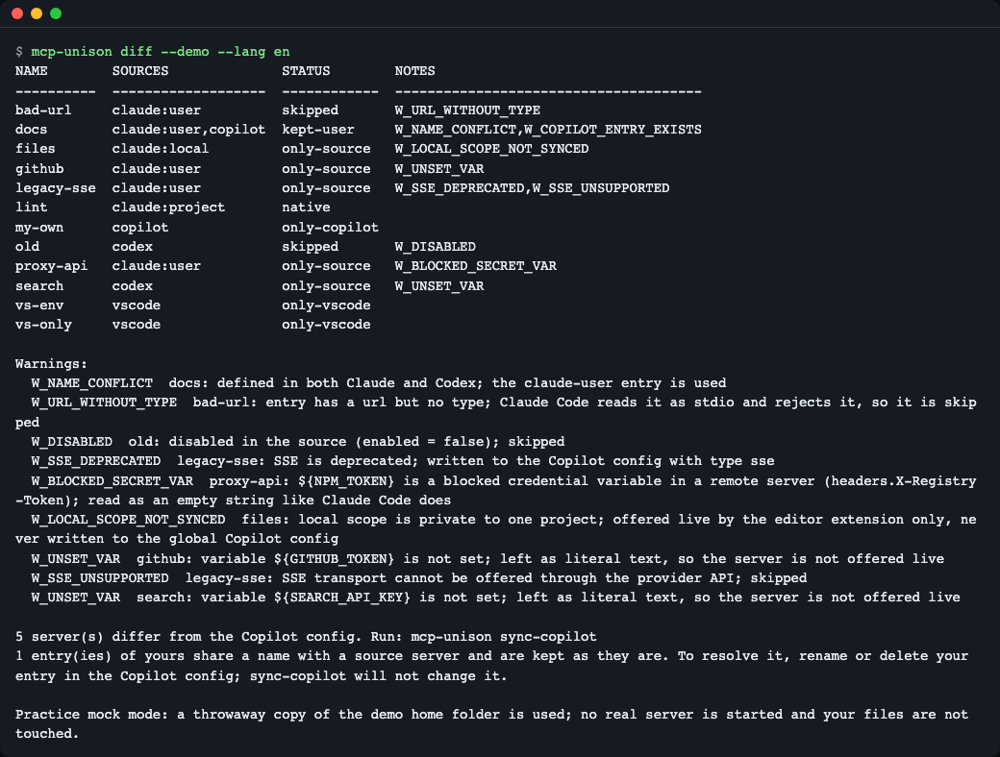
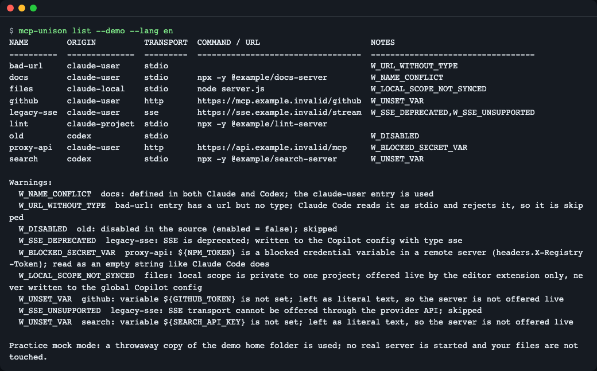
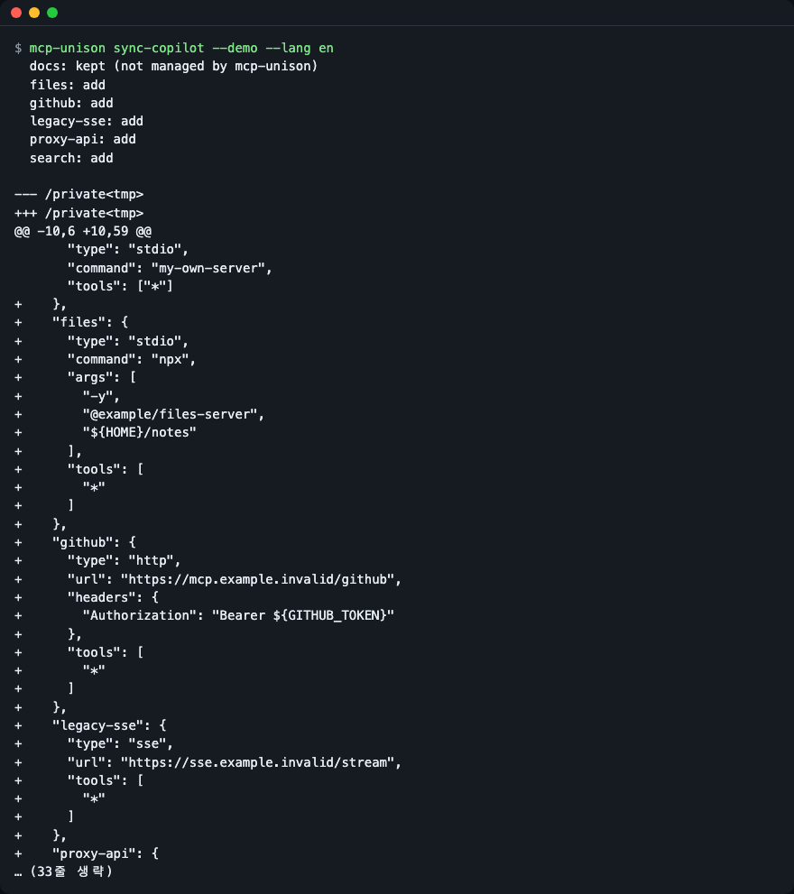
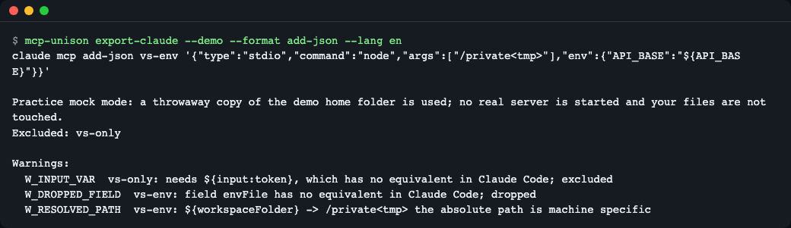
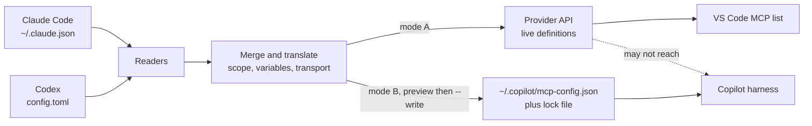

# MCP Unison

**English** | [한국어](README.ko.md)

A VS Code extension (plus a CLI built on the same core) that reuses the MCP servers you already registered in Claude Code or Codex from VS Code chat (Copilot), so you do not retype them by hand. It registers them through VS Code's MCP server definition provider API, can also write them into the Copilot config file with a preview first, and tells you with a warning code whenever a server cannot be translated.


*`mcp-unison diff --demo`: one row per server, where it is defined, and whether the Copilot config matches. Warning codes explain every server that does not carry over.*

## What it adds

- **One source of truth.** Servers from Claude Code (user and local scope in `~/.claude.json`) and Codex (`config.toml`) are offered to VS Code without copying (mode A, "live provider").
- **A safe write path.** `sync-copilot` previews a diff and, only with `--write`, adds or updates the entries it created in `~/.copilot/mcp-config.json`. Your own entries, comments and other keys stay byte for byte (mode B, "file write").
- **Faithful translation.** Scope priority, variable rules and transport differences follow Claude Code's behavior and are pinned by tests. What cannot be moved is skipped with a reason (`W_*` codes), in English or Korean.

## Requirements

| Host | Version checked | Notes |
|---|---|---|
| VS Code | `^1.101.0` required; a probe ran against 1.146.0 | Extension host API `vscode.lm.registerMcpServerDefinitionProvider` |
| Node.js | 20 or newer (checked with 26.13.0) | CLI only; the extension runs inside VS Code |
| Claude Code / Codex | any version that writes `~/.claude.json` / `~/.codex/config.toml` | Only the files are read. Neither tool is started |

## Install

The extension is not on a marketplace yet. Build the package from a clone and install it from the file:

```bash
git clone https://github.com/LeeGyeongPil/mcp-unison.git
cd mcp-unison
npm install
npm run package          # writes mcp-unison-0.1.1.vsix
```

Then in VS Code run **Extensions: Install from VSIX...** and pick `mcp-unison-0.1.1.vsix`.

The CLI works from the same clone:

```bash
npm start                # builds, then runs: mcp-unison diff --demo
node out/src/cli.js --help
```

Node.js 20 or newer is required (for example `brew install node` on macOS, or use the installers at nodejs.org).

## Quick start (practice mock mode)

`--demo` is a **practice mock mode**. It copies the bundled sample home folder (`examples/demo-home`) to a temporary folder and runs the real conversion code on it. No server is started, no network is used and your own files are not touched. Real mode (no `--demo`) reads your actual `~/.claude.json`, `~/.codex/config.toml` and `~/.copilot/mcp-config.json`.

```bash
npm start
```

```text
Practice mock mode: a throwaway copy of the demo home folder is used; no real server is started and your files are not touched.
NAME        SOURCES              STATUS        NOTES
----------  -------------------  ------------  --------------------------------------
bad-url     claude:user          skipped       W_URL_WITHOUT_TYPE
docs        claude:user,copilot  kept-user     W_NAME_CONFLICT,W_COPILOT_ENTRY_EXISTS
files       claude:local         only-source   W_LOCAL_SCOPE_NOT_SYNCED
github      claude:user          only-source   W_UNSET_VAR
legacy-sse  claude:user          only-source   W_SSE_DEPRECATED,W_SSE_UNSUPPORTED
lint        claude:project       native
my-own      copilot              only-copilot
old         codex                skipped       W_DISABLED
proxy-api   claude:user          only-source   W_BLOCKED_SECRET_VAR
search      codex                only-source   W_UNSET_VAR
vs-env      vscode               only-vscode
vs-only     vscode               only-vscode
```

The table is followed by a `Warnings:` list and a summary line. `W_UNSET_VAR` lines disappear if `GITHUB_TOKEN` and `SEARCH_API_KEY` are set in your shell, so your output can differ slightly.

The output language follows `--lang`, then `MCP_UNISON_LANG`, then `LANG`: on a shell with a Korean locale the same command prints Korean. To pin English, run `node out/src/cli.js diff --demo --lang en`.

## Usage

### Status values

| STATUS | Meaning |
|---|---|
| `only-source` | Defined in Claude Code or Codex, missing from the Copilot config |
| `same` | Present in both and equal |
| `different` | Present in both but not equal |
| `kept-user` | You own an entry with the same name. Not drift. Rename or delete yours; `sync-copilot` will not touch it |
| `stale-managed` | An earlier sync wrote this entry but it is no longer needed. The next sync removes it. Counts as drift |
| `native` | Already read by VS Code itself (project `.mcp.json`), so nothing to do |
| `only-copilot` | Yours alone. Never touched |
| `only-vscode` | Only in `.vscode/mcp.json` |
| `skipped` | Cannot be translated; see the warning code |

### 1. Inspect: `list` and `diff`


*`mcp-unison list --demo`: what each server is (stdio, http, sse) and why some are flagged.*

`diff --check` exits with code 1 when the sources and the Copilot config differ, which suits CI or a shell prompt hook. Add `--json` for machine-readable output.

### 2. Sync to the Copilot config: `sync-copilot`


*`mcp-unison sync-copilot --demo`: a preview only. `docs` is kept because you already have an entry with that name.*

The default is a preview: the file is not changed. Add `--write` to apply. The write adds, updates and removes only entries recorded in `mcp-unison.lock.json` next to the config, saves a `.bak` backup, and reports a managed entry you edited by hand as a conflict (exit 1). Running it a second time prints `no changes`. An existing file keeps its permissions (a new file and the lock file get 0600), a symlinked config is written through to the real file, and the `.bak` copy has the same mode. Claude Code local-scope servers are not written (see `W_LOCAL_SCOPE_NOT_SYNCED` below). Variables are written as `${NAME}`, never as their values, so no secret is copied into the file.

In VS Code the same flow is the command **MCP Unison: Sync to Copilot config** (diff first, then confirm).

### 3. Export the other way: `export-claude`


*`mcp-unison export-claude --demo --format add-json`: ready-to-paste `claude mcp add-json` commands. Servers that need `${input:...}` are excluded.*

### VS Code commands

| Command | What it does |
|---|---|
| MCP Unison: Refresh | Re-read the sources now |
| MCP Unison: Sync to Copilot config | Preview, confirm, write managed entries |
| MCP Unison: Show Drift | Show the same table as `diff` |
| MCP Unison: Export to Claude Code | Convert `.vscode/mcp.json` |
| MCP Unison: Show in Copilot Sessions | Nudge VS Code to load extension-provided servers (see below) |
| MCP Unison: Choose Language | English or Korean, saved globally |

The VS Code window itself could not be captured in the build environment, so the screenshots in this README show the CLI. The extension's provider logic is tested against a stand-in for the `vscode` module, and a real-editor test exists but runs only in CI (see Development).

## Settings

| Key | Default | Description |
|---|---|---|
| `mcpUnison.sources.claude` | `true` | Read Claude Code servers |
| `mcpUnison.sources.codex` | `true` | Read Codex servers |
| `mcpUnison.copilotSync` | `ask` | `off`, `ask` or `auto`: whether changes are written to the Copilot config |
| `mcpUnison.blockedRemoteVars` | `[]` | Extra variable names blocked in remote `url` and `headers` |
| `mcpUnison.language` | `auto` | `auto`, `en` or `ko`. `auto` decides once from the editor language |

CLI language: `--lang en|ko`, then the `MCP_UNISON_LANG` variable, then `LC_ALL`, `LC_MESSAGES` and `LANG`. Anything other than Korean gives English. Other variables: `CODEX_HOME` and `COPILOT_HOME` move the Codex and Copilot folders; `--home <folder>` overrides both.

## How it works



1. Readers parse the source files. A parse error stops with the file path (exit 2).
2. Merge follows Claude Code: local scope over project over user, and a same-name entry replaces the whole entry (fields are not combined). On a Claude and Codex name clash Claude wins with `W_NAME_CONFLICT`.
3. Variables: an unset `${VAR}` stays literal text with `W_UNSET_VAR`; an empty string counts as set, so `${VAR:-d}` becomes empty; a credential variable (`NPM_TOKEN`, `ANTHROPIC_API_KEY` and similar) inside a remote `url` or `headers` reads as empty with `W_BLOCKED_SECRET_VAR`. `$VAR` without braces stays literal.
4. Mode A hands definitions to VS Code with `vscode.lm.registerMcpServerDefinitionProvider`. A server with an unset variable, SSE transport, or a `url` without `type` is not offered. Each definition has a content hash as its `version`, so only changed servers are reported as changed.
5. Mode B writes entries into the Copilot config text with minimal string edits, because a general JSON editor re-formatted surrounding user lines in testing.

Access: the extension reads those config files, watches them by polling (once a second by default), and writes only the Copilot config when you confirm. It makes no network calls and starts no MCP server.

### Why file write is the main path today

The live provider (mode A) is the cleaner idea, but VS Code's default Copilot harness currently does not always see servers that extensions provide: [microsoft/vscode#343729](https://github.com/microsoft/vscode/issues/343729) (open when this was written, reproduced on 1.143.1 per the report). The extension-provided collection loads lazily, and only a local chat request, `MCP: List Servers` or the refresh button triggers it. Sessions in the Agent Host may not list the servers. Until that is fixed, treat **Sync to Copilot config (mode B)** as the reliable path and mode A as a bonus for places where it works. `MCP Unison: Show in Copilot Sessions` nudges the lazy load.

Two more honest limits:

- Organization allow lists may not apply to extension-provided servers ([#345036](https://github.com/microsoft/vscode/issues/345036)). On managed machines, a server can be blocked.
- The Copilot entry keys (`type`, `tools: ["*"]`) follow the research notes for the file format. They have not been checked against a running Copilot session.

## Which mode should I use?

| Situation | Use |
|---|---|
| You want the servers in a Copilot agent session today | Mode B: **Sync to Copilot config** (`sync-copilot --write`) |
| You want servers to appear in the VS Code MCP list without writing any file | Mode A: the live provider, on by default after install |
| You want Claude Code local-scope servers (private to one project) | Mode A only. They are never written to the global Copilot file |
| You want CI to notice drift | `diff --check` (exit 1 on drift) |
| You manage an organization-controlled machine | Check with your admin first; see Known limitations |

When this tool fits: you registered MCP servers in Claude Code or Codex and want the same ones in VS Code chat, with a diff before anything is written. For editing `.vscode/mcp.json` yourself, VS Code has [built-in MCP support](https://code.visualstudio.com/docs/copilot/customization/mcp-servers). To manage one MCP server list for many agent tools, check whether your tools document their own sharing or import options.

## What gets translated and what is skipped

Field mapping (source to Copilot config entry):

| Source | Field | Becomes | Notes |
|---|---|---|---|
| Claude Code, Codex | `command`, `args`, `env` | same fields, `type: "stdio"` | Variables stay as `${NAME}` text |
| Claude Code | `type: "http"` + `url`, `headers` | `type: "http"` | Needs an explicit `type` (`W_URL_WITHOUT_TYPE`) |
| Claude Code | `type: "sse"` | `type: "sse"` in the file only | Not offered live (`W_SSE_UNSUPPORTED`) |
| Claude Code | `oauth` | `clientId` only | `W_OAUTH_PARTIAL` |
| Claude Code | `headersHelper` | skipped | `W_HEADERS_HELPER` |
| Codex | `enabled = false` | skipped | `W_DISABLED` |
| VS Code `.vscode/mcp.json` | `${input:...}`, `envFile` | excluded or dropped on export | `W_INPUT_VAR`, `W_DROPPED_FIELD` |
| VS Code `.vscode/mcp.json` | `${workspaceFolder}` | absolute path on export | `W_RESOLVED_PATH` |

Variable syntax:

| Written as | Result |
|---|---|
| `${VAR}` set | Mode A: value filled in memory. Mode B: stays `${VAR}` in the file |
| `${VAR}` unset | Stays literal text, `W_UNSET_VAR`, not offered live |
| `${VAR:-default}` | The default when `VAR` is unset; an empty string counts as set |
| `$VAR` (no braces) | Stays literal text |
| Credential variable in a remote `url` or `headers` | Read as empty, `W_BLOCKED_SECRET_VAR` (stdio `env` is unaffected) |

Local-scope servers: Claude Code keeps `projects[<path>].mcpServers` private to one project, so `sync-copilot` does not copy them into the global Copilot file (`W_LOCAL_SCOPE_NOT_SYNCED`). The editor extension still offers them live for the open folder. If a local server shadows a user server of the same name, the Copilot file gets the user definition.

Every warning code:

| Code | Meaning | What to do |
|---|---|---|
| `W_NAME_CONFLICT` | Same name in Claude and Codex | Claude wins; rename one if you want both |
| `W_UNSET_VAR` | A `${VAR}` is not set | Set it before starting the editor |
| `W_BLOCKED_SECRET_VAR` | Credential variable in a remote `url` or `headers` | Intentional; use stdio `env` |
| `W_URL_WITHOUT_TYPE` | `url` without `type` | Add `"type": "http"` in the source |
| `W_SSE_UNSUPPORTED` | SSE cannot go through the provider API | Use mode B, or switch to http |
| `W_SSE_DEPRECATED` | SSE is deprecated | Written with `type: sse`; consider http |
| `W_TRANSPORT_UNSUPPORTED` | Transport has no equivalent | Skipped; nothing to fix here |
| `W_HEADERS_HELPER` | `headersHelper` would run a shell command | Skipped on purpose; use a static header or env |
| `W_OAUTH_PARTIAL` | Only `oauth.clientId` is carried | Re-authorize in the target if needed |
| `W_DISABLED` | Disabled in the source | Enable it in the source |
| `W_INVALID_ENTRY` | Entry unusable (the field is named) | Fix the field in the source |
| `W_URL_VAR_COPILOT` | Copilot does not expand variables in `url` | Write the literal URL |
| `W_LOCAL_SCOPE_NOT_FOUND` | No `projects` key matches this folder | Check `--project`, case and trailing slash |
| `W_LOCAL_SCOPE_NOT_SYNCED` | Local scope is project-private | Live provider only; move the server to user scope to sync |
| `W_COPILOT_ENTRY_EXISTS` | You own an entry with that name | Rename or delete yours |
| `W_INPUT_VAR` | `${input:...}` has no Claude equivalent | Excluded from export |
| `W_RESOLVED_PATH` | A path was made absolute | Check it fits the other machine |
| `W_DROPPED_FIELD` | Field has no equivalent | Dropped on export |
| `W_COMMAND_NOT_ON_PATH` | `command` not found on the extension host `PATH` | Install it or use an absolute path |

## CLI reference

```text
mcp-unison <command> [options]
```

| Command | What it does |
|---|---|
| `list` | Merged servers and why some cannot be moved |
| `diff` | Compare sources with the Copilot config (`--check`: exit 1 on drift) |
| `sync-copilot` | Preview, or `--write` to apply, managed entries |
| `export-claude` | Convert `.vscode/mcp.json` to Claude Code form |

| Option | Applies to | Meaning |
|---|---|---|
| `--home <dir>` | all | Use this folder as the home folder (overrides `CODEX_HOME`, `COPILOT_HOME`) |
| `--project <dir>` | all | Project folder (default: current folder) |
| `--json` | all | Machine-readable output |
| `--demo` | all | Run on a throwaway copy of the sample home (practice mock mode) |
| `--check` | `diff` | Exit 1 when drift exists |
| `--write` | `sync-copilot` | Apply changes; default is a preview |
| `--format <mcp-json\|add-json>` | `export-claude` | Output format |
| `--blocked-var <name>` | all | Extra credential variable blocked in remote servers; repeatable |
| `--lang <en\|ko>` | all | Output language |
| `-h`, `--help`, `-v`, `--version` | | Help, version |

Exit codes: `0` ok; `1` drift (`diff --check`) or conflict (`sync-copilot --write`); `2` usage error or a source file that cannot be parsed (the message names the file, line and column).

`--json` top-level fields: `list` and `diff` give `servers` and `warnings`; `sync-copilot` gives `changed`, `written`, `actions`, `conflicts`, `diff`, `warnings`; `export-claude` gives `format`, `text`, `exported`, `excluded`, `warnings`. Each warning has `code`, `server`, `message` and, when relevant, `field` and `detail`.

## Safety

- Source files (`~/.claude.json`, `~/.codex/config.toml`, `.vscode/mcp.json`) are only read, never changed.
- The only file written is `~/.copilot/mcp-config.json`, and only after a preview plus `--write` (or your confirmation in VS Code). `copilotSync: auto` is opt-in.
- Each write saves a `.bak`, keeps file permissions, and tracks what it created in `mcp-unison.lock.json`. Only entries in that lock are ever changed or removed; your entries, comments and other keys stay as they are.
- A managed entry you edited by hand is reported as a conflict and left alone.
- Secret values are never written: variables go to the file as `${NAME}` text. Mode A fills values in memory only.
- No network calls, and no MCP server is started by this tool.

## Known limitations

- Visibility of extension-provided servers in Copilot agent sessions: [microsoft/vscode#343729](https://github.com/microsoft/vscode/issues/343729) (see "Why file write is the main path today").
- Organization allow lists may not apply to extension-provided servers: [#345036](https://github.com/microsoft/vscode/issues/345036).
- The Copilot entry keys (`type`, `tools: ["*"]`) are not verified against a running Copilot session.
- Only the first workspace folder is used.
- Windows paths are tested through the platform argument only (no Windows CI yet).
- A Codex string that contains a literal `${...}` is treated as a variable reference.
- The VS Code window could not be captured here; screenshots show the CLI.

## Troubleshooting

| Symptom | Cause | Fix |
|---|---|---|
| Servers do not show in a Copilot agent session | Lazy loading bug #343729 | Run **Sync to Copilot config**, or run `MCP: List Servers` once |
| `diff` says a server is `skipped` with `W_URL_WITHOUT_TYPE` | A `url` entry without `type`; Claude Code rejects it | Add `"type": "http"` in the source |
| `W_UNSET_VAR` for `${GITHUB_TOKEN}` | The variable is not set in the environment that starts the editor | Set it and restart VS Code |
| `W_BLOCKED_SECRET_VAR` | Credential variable inside a remote `url` or `headers` | Intentional (same as Claude Code). Use a stdio `env` instead |
| `sync-copilot` keeps my entry with `W_COPILOT_ENTRY_EXISTS` | An entry with that name already exists and was not created by this tool | Rename or remove it, then sync again |
| `--write` exits 1 with CONFLICT | You edited a managed entry by hand | Review the diff, remove it from `mcp-unison.lock.json` or revert your edit |
| Exit 2 | A source file failed to parse | Fix the file named in the error |

## Development

```bash
npm install
npm test                      # tsc, then 87 tests; no keys or network needed
npm run package               # builds the .vsix
node scripts/check-vsix.mjs   # prints "vsix ok"
npm run test:integration      # real VS Code; needs a display (CI uses xvfb)
```

Changes are listed in [CHANGELOG.md](CHANGELOG.md).

## License

MIT.
